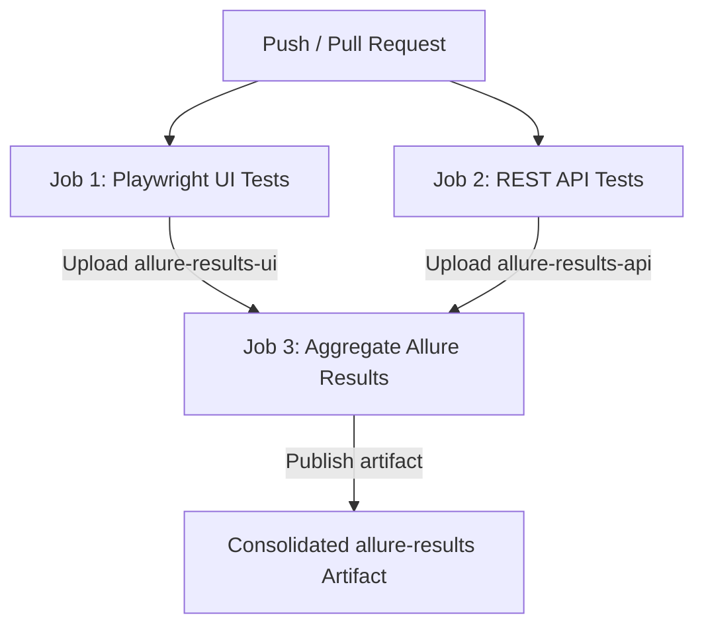

# Enterprise Quality Engineering & Test Automation Framework

[](https://github.com/ishansaha-dev/QA_Project01/actions/workflows/qa-pipeline.yml)
[](https://www.python.org/)
[](https://playwright.dev/python/)
[](https://docs.pytest.org/)
[](https://k6.io/)
[](https://allurereport.org/)
[](LICENSE)

A production-grade, CI/CD-integrated Quality Engineering test framework designed to demonstrate modern Staff SDET automation standards across **Web UI Automation**, **REST API Automation & Contract Testing**, and **Performance/Load Engineering**.

---

## 🏛 Framework Architecture & Key Design Decisions

```
QA_Project01/
├── .github/
│   └── workflows/
│       └── qa-pipeline.yml        # CI/CD: Parallel UI & API execution + Allure aggregation
├── api_client/
│   ├── __init__.py
│   └── booking_client.py          # HTTP Session client wrapper for Restful-Booker API
├── config/
│   ├── __init__.py
│   └── settings.py                # Centralized environment config (.env loader)
├── pages/                         # Strict Page Object Model (POM) — Zero Assertions
│   ├── __init__.py
│   ├── base_page.py               # Shared browser interaction & navigation helpers
│   ├── login_page.py              # Login page locators & actions
│   ├── inventory_page.py          # Product catalog & cart interaction
│   ├── cart_page.py               # Cart items & checkout transition
│   └── checkout_page.py           # Multi-step checkout & price parsing
├── performance/
│   └── booking_load_test.js       # k6 load script with SLA thresholds (p95 < 800ms)
├── schemas/
│   ├── __init__.py
│   ├── booking_schema.json        # JSON Schema Draft-07 for Booking entities
│   ├── booking_response_schema.json # JSON Schema for creation response
│   └── booking_model.py           # Pydantic v2 data models for type enforcement
├── tests/
│   ├── api/
│   │   ├── test_booking_crud.py   # Full CRUD persistence & schema contract validation
│   │   └── test_booking_negative.py # Authorization guards (403), 404s & bad credentials
│   └── ui/
│       ├── test_auth.py           # Positive & parametrized negative authentication
│       └── test_checkout_e2e.py   # Full E2E purchase with subtotal + tax price math
├── utils/
│   ├── __init__.py
│   └── schema_validator.py        # Schema loading & jsonschema validator utility
├── .env.example                   # Environment configuration template
├── conftest.py                    # Session/function fixtures & failure artifact hooks
├── pytest.ini                     # Markers, paths, and Allure test-runner configuration
└── requirements.txt               # Pinned dependencies
```

### 1. Strict Page Object Model (POM) Separation
* **Zero Assertions in Page Classes**: `pages/` contains **strictly** locators and page interactions. All assertions reside inside test classes (`tests/`), maintaining a clean boundary between UI state control and validation logic.
* **Resilient Locators**: Zero fragile or auto-generated XPaths (`/html/body/...`). All selectors leverage standard `[data-test="..."]` attributes matching the DOM specification.
* **No Arbitrary Sleeps**: `time.sleep()` and `page.wait_for_timeout()` are strictly banned. Tests rely entirely on Playwright web-first assertions (`expect(locator).to_be_visible()`) and auto-waiting mechanisms.

### 2. Automatic Failure Diagnostics Engine (`conftest.py`)
When any UI test fails, the test runner automatically hooks into the failure event via pytest hooks and captures:
1. **Full-page screenshot (`.png`)** embedded directly into the test failure report.
2. **Playwright Trace file (`.zip`)** with DOM snapshots, console logs, and network waterfalls (viewable via `trace.playwright.dev`).
3. **Current Page URL** logged to the report for instant root-cause analysis.
4. **Clean Tracing Discard**: Passing tests automatically stop and discard trace memory, preventing disk and RAM bloat.

### 3. API Contract & Persistence Testing
* **Dual-Layer Validation**: Employs **JSON Schema Draft-07** (`jsonschema`) for strict schema compliance combined with **Pydantic v2** (`schemas/booking_model.py`) for data parsing and type validation.
* **Explicit Auth Token Guards**: The API client separates default session tokens from explicit `token=None` invocations, ensuring that negative security checks (unauthorized 403 responses) cannot accidentally inherit session credentials.
* **Full CRUD Lifecycle**: Tests complete lifecycle persistence (Create -> Read -> Update -> Partial Update -> Read -> Delete -> Verify 404).

### 4. 100% Test Isolation & Parallelism
Every test is fully decoupled and independent. UI contexts are freshly isolated per test, and API fixtures automatically clean up created test entities during fixture teardown. The entire suite is safe for parallel execution using `pytest-xdist` (`pytest -n auto`).

---

## 📊 Comprehensive Test Coverage

### UI Automation (`tests/ui/`)

| Test Identifier | Description | Test Type | Validations |
|---|---|:---:|---|
| `test_valid_login_redirects_to_inventory` | Standard user login | Positive | URL navigation, inventory container visibility |
| `test_negative_login_shows_error[locked_out_user]` | Locked out user login attempt | Negative (Parametrized) | Error banner visibility & exact message check |
| `test_negative_login_shows_error[invalid_password]` | Invalid password login attempt | Negative (Parametrized) | Error banner visibility & exact message check |
| `test_checkout_two_items_with_price_and_tax_math` | Full purchase journey | E2E Regression | Cart counter verification, **floating-point accurate price math (`subtotal + tax == total`)**, order completion banner |

### API Automation (`tests/api/`)

| Test Identifier | Method & Endpoint | Test Type | Validations |
|---|---|:---:|---|
| `test_create_booking_schema_and_values` | `POST /booking` | Functional & Contract | HTTP 200, JSON Schema validation, Pydantic parsing, payload equality |
| `test_get_booking_by_id` | `GET /booking/{id}` | Functional & Contract | HTTP 200, JSON Schema validation, data integrity |
| `test_update_booking_put_persistence` | `PUT /booking/{id}` | Functional & Persistence | HTTP 200 with auth cookie, JSON Schema, GET query to verify persisted state |
| `test_partial_update_booking_patch_persistence` | `PATCH /booking/{id}` | Functional & Persistence | HTTP 200, selective field mutation, unmutated fields retained |
| `test_delete_booking_persistence` | `DELETE /booking/{id}` | Functional & Persistence | HTTP 201, subsequent `GET` returns HTTP 404 |
| `test_full_crud_lifecycle` | Full CRUD Chain | End-to-End | Sequence: Create -> Get -> PUT -> PATCH -> Delete -> Verify 404 |
| `test_update_booking_without_token_returns_403` | `PUT /booking/{id}` | Security / Auth | HTTP 403 Forbidden |
| `test_update_booking_with_invalid_token_returns_403` | `PUT /booking/{id}` | Security / Auth | HTTP 403 Forbidden with malformed token |
| `test_partial_update_without_token_returns_403` | `PATCH /booking/{id}` | Security / Auth | HTTP 403 Forbidden |
| `test_delete_booking_without_token_returns_403` | `DELETE /booking/{id}` | Security / Auth | HTTP 403 Forbidden |
| `test_delete_booking_with_invalid_token_returns_403` | `DELETE /booking/{id}` | Security / Auth | HTTP 403 Forbidden with bad token |
| `test_get_nonexistent_booking_returns_404` | `GET /booking/999999999` | Error Handling | HTTP 404 Not Found |
| `test_auth_with_invalid_credentials_returns_no_token`| `POST /auth` | Security / Auth | HTTP 200 with `Bad credentials`, no token returned |

### Performance Testing (`performance/`)

| Script | Engine | Scenarios / Stages | SLA Thresholds |
|---|:---:|---|---|
| `booking_load_test.js` | **k6** | Ramp-up (5 VUs / 10s) -> Steady State (10 VUs / 30s) -> Ramp-down (0 VUs / 10s) | **p(95) < 800ms**, `http_req_failed < 5%`, `custom_error_rate < 5%` |

---

## 🛠 Tech Stack & Tools

* **Core Language:** Python 3.11+ / 3.12
* **UI Test Engine:** [Playwright](https://playwright.dev/python/) (Python synchronous API)
* **Test Framework:** [pytest](https://pytest.org/) (with `pytest-xdist` for multi-core parallelism)
* **API Client:** [Requests](https://requests.readthedocs.io/)
* **Contract Validation:** [jsonschema](https://python-jsonschema.readthedocs.io/) + [Pydantic v2](https://docs.pydantic.dev/)
* **Load Testing:** [Grafana k6](https://k6.io/) (ES6 JavaScript)
* **Reporting:** [Allure Report](https://allurereport.org/) + `pytest-html`
* **Configuration:** [python-dotenv](https://github.com/theskumar/python-dotenv)
* **CI/CD:** [GitHub Actions](https://github.com/features/actions)

---

## 🚀 Getting Started

### 1. Prerequisites
* **Python 3.11+** installed (`python --version`)
* **Git** installed
* *(Optional)* **k6** installed for local load testing (`winget install k6` or `brew install k6`)

### 2. Clone & Setup Virtual Environment

```bash
# Clone the repository
git clone https://github.com/ishansaha-dev/QA_Project01.git
cd QA_Project01

# Create virtual environment
python -m venv venv

# Activate virtual environment
# Windows (PowerShell):
.\venv\Scripts\Activate.ps1
# macOS / Linux:
source venv/bin/activate
```

### 3. Install Dependencies & Playwright Browsers

```bash
# Upgrade pip and install pinned requirements
pip install --upgrade pip
pip install -r requirements.txt

# Install Playwright Chromium browser binary
playwright install chromium
```

### 4. Configure Environment Variables

```bash
# Copy the example environment file
cp .env.example .env
```

The default values in `.env` are pre-configured to run out of the box:
```ini
BASE_URL=https://www.saucedemo.com
VALID_USER=standard_user
LOCKED_USER=locked_out_user
PASSWORD=secret_sauce

API_BASE_URL=https://restful-booker.herokuapp.com
API_USERNAME=admin
API_PASSWORD=password123

HEADLESS=true
BROWSER=chromium
```

---

## ⚡ Test Execution Commands

### Run All Tests
```bash
pytest -v
```

### Run UI Automation Tests Only
```bash
# Run headless (default)
pytest tests/ui/ -v

# Run headed (browser UI visible for debugging)
pytest tests/ui/ -v -o HEADLESS=false
```

### Run REST API Tests Only
```bash
pytest tests/api/ -v
```

### Run Tests in Parallel (`pytest-xdist`)
```bash
# Automatically distribute across available CPU cores
pytest -n auto -v
```

### Run Specific Test Groups by Marker
```bash
# Run only UI tests
pytest -m ui -v

# Run only API tests
pytest -m api -v
```

### Generate & View Allure Test Reports
```bash
# 1. Execute tests and collect results
pytest --alluredir=allure-results

# 2. Serve the interactive Allure report in your browser
allure serve allure-results
```

### Inspect Playwright Failure Traces
When a UI test fails, open the generated trace zip in the Playwright trace viewer:
```bash
playwright show-trace test-results/<test_name>/trace.zip
```

---

## 📈 Performance & Load Testing with k6

Execute the k6 load test script against Restful-Booker:

```bash
k6 run performance/booking_load_test.js
```

### Overriding Parameters in Load Tests
```bash
k6 run -e API_BASE_URL="https://restful-booker.herokuapp.com" performance/booking_load_test.js
```

### Expected SLA Output:
```
✓ create booking status is 200
✓ create returns valid bookingid
✓ get booking status is 200
✓ update booking status is 200
✓ delete booking status is 201

checks.........................: 100.00%
http_req_duration..............: avg=210ms  p(95)=420ms < 800ms [✓]
http_req_failed................: 0.00%                   < 5%   [✓]
custom_error_rate..............: 0.00%                   < 5%   [✓]
```

---

## 🔄 CI/CD Pipeline (GitHub Actions)

The repository includes a production-grade workflow (`.github/workflows/qa-pipeline.yml`) that executes on every `push` and `pull_request` to `main` / `master`:



* **Parallel Execution**: UI tests and API tests run simultaneously on separate Ubuntu runners.
* **Auto-Provisioning**: Automatically installs OS dependencies and Chromium for Playwright.
* **Artifact Archival**:
  * On failure: uploads full trace zip files and screenshots (`test-results/`).
  * On every run: consolidates and publishes the unified `allure-results` artifact (retained for 30 days).

---

## 👤 Author & Contact

**Ishan Saha**  
Staff Software Development Engineer in Test (SDET)  
*Specializing in High-Reliability Test Architecture, Quality Engineering & Distributed Performance Systems.*
